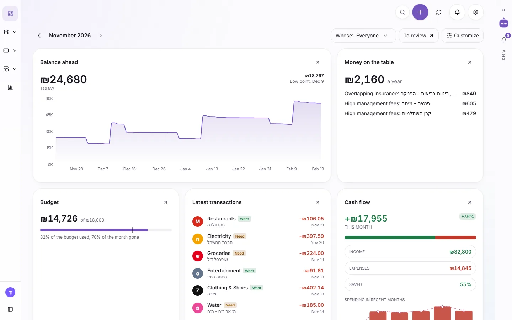
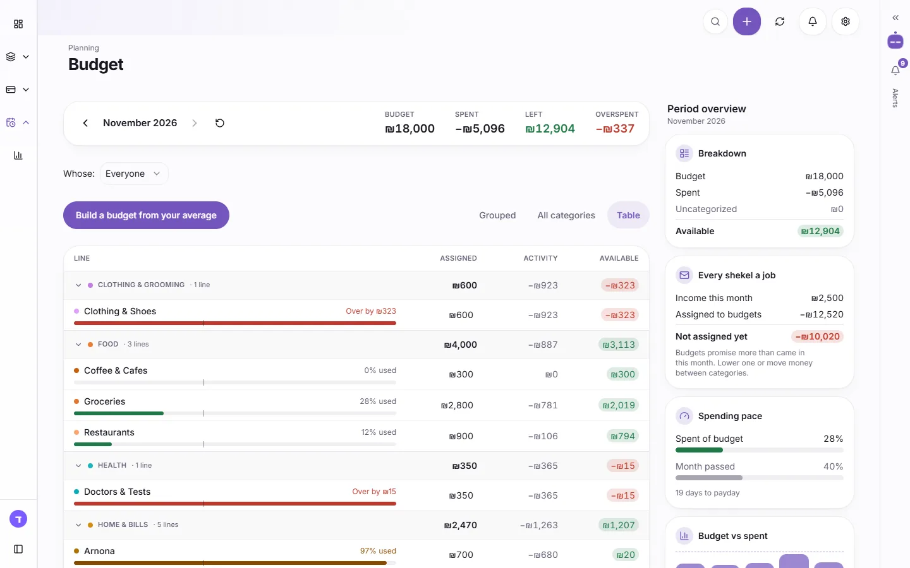
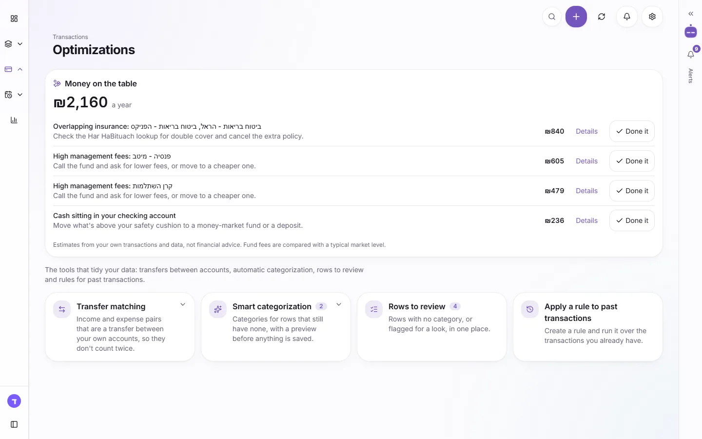
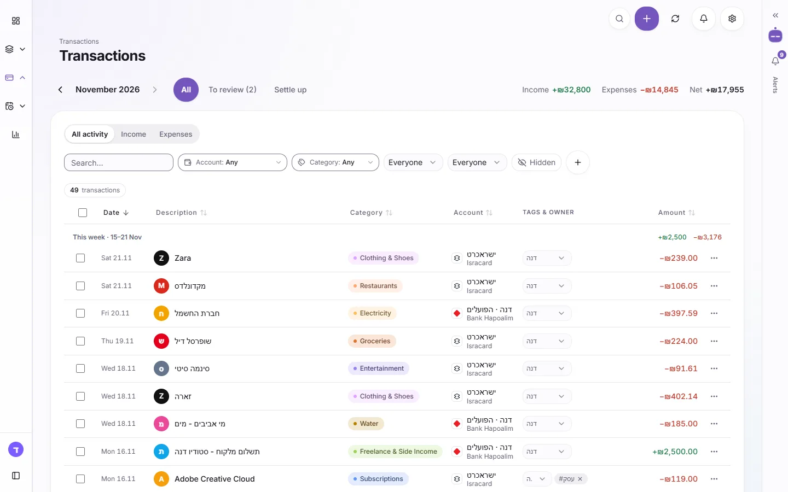
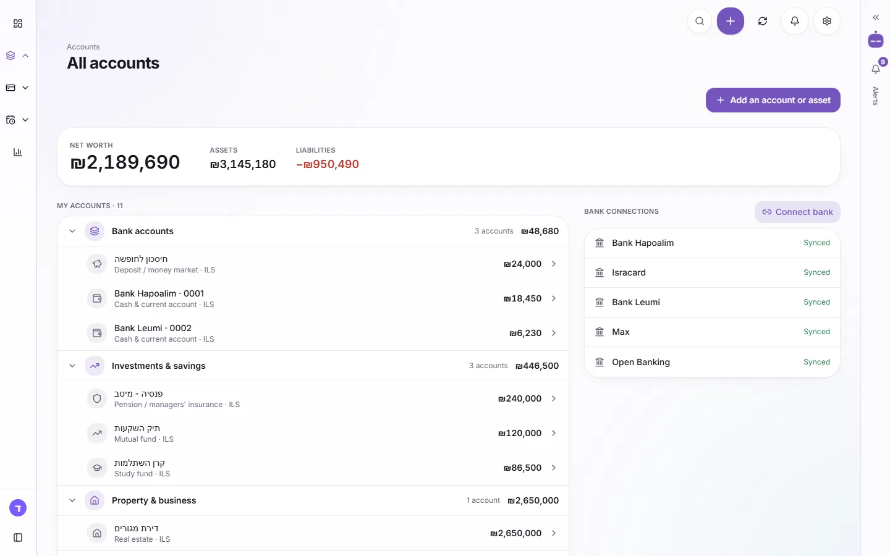
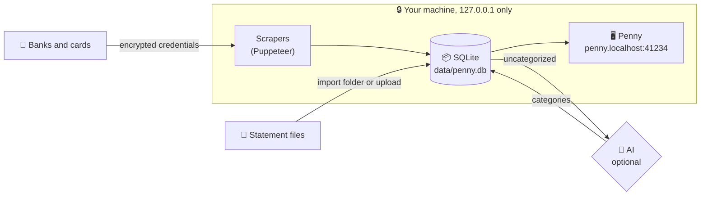

<div align="center">

# Penny

**A calm, local-first money app for Israeli households.**
Your banks, your budget and your future in one place, on your own computer.

[](https://github.com/Sergey-Bar/Penny/releases)
[](https://github.com/Sergey-Bar/Penny/stargazers)
[](https://github.com/Sergey-Bar/Penny/releases/latest)
[](https://github.com/Sergey-Bar/Penny/actions/workflows/ci.yml)
[](#license)

[עברית](README.md) · [Download](#install) · [Clickable demo](https://sergey-bar.github.io/Penny/en/demo/) · [What's new](#whats-new-in-020) · [Features](#features) · [How it works](#how-it-works) · [Security](#security-at-a-glance) · [Contributing](#contributing) · [Website](https://sergey-bar.github.io/Penny/en/)

**Download:** [](https://github.com/Sergey-Bar/Penny/releases/latest) [](https://github.com/Sergey-Bar/Penny/releases/latest) [](#docker)



</div>

> [!WARNING]
> Penny is a personal, local-only tool. Scraping financial institutions may violate their terms of service. Use it only for your own accounts, on your own machine. **Do not deploy it as a hosted service.**

## What's new in 0.2.0

- **Money on the table:** one yearly figure for everything you could save (high fund fees, overlapping insurance, fees, interest, idle cash), with the next step for each.
- **Smart without AI:** automatic categories from a dictionary of about 200 Israeli merchants and from what you taught it; "why spending changed" per merchant; donations found for the section 46 tax credit.
- **A full dashboard** of tiles, an accounts tree, loans, investments with buys and sells, splitting expenses with people, envelope budgeting and credit score tracking.
- **Correct numbers:** charges on the 1st land in their month, Max card bills aren't counted twice, and a balance check flags missing transactions.
- **Windows updates itself**, and Telegram sends a summary three times a week.

The full list is in [CHANGELOG.md](CHANGELOG.md). You can also [try the demo on the website](https://sergey-bar.github.io/Penny/en/demo/) without installing anything.

## Why Penny?

Israeli banks have poor exports, global budgeting apps don't understand shekels, credit points or study funds, and most cloud finance apps want your bank password on their servers.

Penny runs on your laptop. It pulls transactions straight from your banks and credit cards, keeps them in one SQLite file you can copy and back up, and lets an AI of your choice sort them into categories, or none at all. Then it helps with the questions that actually matter in Israel: am I on track this month, do I have a safety net, am I paying too much in fees, and am I getting every tax benefit I'm owed.

Nothing leaves your machine except the calls you choose: to your bank, and to an AI provider if you pick a cloud one.

## Features

### Everyday money
- **A dashboard** of tiles you can show or hide (expected balance, money on the table, cash flow, spending structure, who spent what), and a calm **Focus** screen with just the bottom line.
- **Transactions** grouped by week, with category colours, search, filters, bulk edit, splits and tags. Add cash or manual transactions in a quick, amount-first sheet.
- **Budgets** with pacing, a 50/30/20 view, a table, an envelope view (how much of your income already has a job) and per-category detail.
- **Money on the table.** One yearly figure for everything you could save: fees, overdraft interest, FX markup, fund fees above the market, overlapping insurance, idle cash and the donation tax credit. Each with its next step; what you mark done counts as saved.
- **Why spending changed.** This month against the same days last month or last year, per merchant: price, volume, new, gone or one-off.
- **Splitting with people.** Mark who owes you part of an expense and see what each person owes, with "paid it all back" in one tap.
- **Category families.** Groups and subcategories share a colour family; pick categories by colour, A-Z or group, and create your own.
- **Financial health** score with one warnings button that lists everything that needs care.
- **What's ahead.** Upcoming charges, recurring bills and a cash-flow forecast, including a separate balance per bank account with a range, and a card for every credit card attached to the account that pays it.
- **Planned expenses.** A purchase you know is coming (a trip, a device, a repair) is written once, joins the forecast, and matches itself to the real charge when it arrives.
- **Business share and a business report.** A transaction that is partly work is marked with a business percentage; the original amount stays in the cash flow and card charges, and personal reports show only the household share. The business report (More → Business report) groups that share by month, category and merchant, with CSV export.

### Israeli money tools
More than 25 calculators and guided tools, ordered by life stage, each marked with the year its figures are valid for:

| Area | Tools |
|---|---|
| Tax | Credit points and tax-refund check (with a Form 135 checklist), tax-benefit deposits to pension and study fund, loss offset (Form 867), net from gross |
| Pension and retirement | Your fees against the market (links to Gemel-Net, Pensia-Net, Bituach-Net), clearing-house report guide, investment track choice, annuity vs lump sum, severance when changing jobs, early-retirement bridge to 67 |
| Safety net | Emergency fund, insurance list with double-insurance check, forgotten money (Har HaKesef) checklist, benefits check (work grant, reserve duty, child savings, arnona discounts) |
| Big decisions | Mortgage with 5-year variable tracks and Bank of Israel rules, prepay vs invest, rent vs buy, discounted-home lottery, car cost, lease vs buy |
| Everyday | Bank fee audit against the basic track, debt payoff, loan cost, savings goals, vacation budget, kids' investing |

Plus a **knowledge center** of short original guides in Hebrew and English, and daily tips.

### Household
- **Profiles that share one household,** in a "who's using?" screen. Each person keeps their own home layout and accessibility choices.
- **Pip,** a small companion whose mood follows the household's finances. Pip is also the household's coach: alerts, insights and advice in a side rail, with one count on every screen. Each profile has its own picture (or its initial on a colour).
- **Every account in one place:** an accounts tree with group totals, a page per account, loans with progress, holdings with buys and sells, and your credit score over time.
- **Goals,** net worth, investments and pension balances (synced from Clal, Harel, Meitav, Menora and Migdal, or imported from your agent's report), and a "family document" for the day someone else needs to find everything.
- **Insurance** in one place: policies, what they cover and the excess, the renewal date, the agent, the documents, and the payments that match from the bank to the policy.
- **A lifetime money model** to age 90, and a coach that turns the month's numbers into ranked advice.
- **Demo mode** with a complete made-up household, including connected banks, cards, open banking and investment houses: see every screen without a bank connection and without touching real data.

### Getting data in
- **Automatic:** 18 Israeli banks and card companies via [`israeli-bank-scrapers`](https://github.com/eshaham/israeli-bank-scrapers), on a daily schedule.
- **Manual:** drop a CSV, XLSX or XLS statement into the app or into a watched import folder. A transaction that comes from both is stored once.
- **Smart sheet:** paste a table from any source, from Excel or Google Sheets to a bank file or a list you typed, and fix each cell in the grid itself: date, amount, type, account, category, tags, owner and business percentage. Duplicates are found per account before saving, and the whole import can be undone.
- **Onboarding** walks a new user through profile and picture, connecting or importing, a monthly target, budgets, an optional AI provider and a short tour. It can be skipped, resumed and reopened.

### Language and accessibility
- **Hebrew first,** with a full right-to-left layout, and English. Bank names, categories, numbers and dates are localized.
- **Accessibility menu** (Alt+A): text size, contrast, stop animations, readable font, link highlighting and more, saved per profile, with an accessibility statement in line with IS 5568 and WCAG 2.2 AA.
- **Privacy mode** (Ctrl/⌘+Shift+P) hides amounts on screen.
- **Themes:** light, dark or follow the device, with soft motion for every open and close.

### Also
- **Ask your money** in plain language, and a **Telegram bot** for instant spending feedback.
- **Phone access on your Wi-Fi** (opt-in), installable as a web app.
- **Menu bar / tray companion** on macOS and Windows.

## Screenshots

<table>
<tr>
<td width="50%"></td>
<td width="50%"></td>
</tr>
<tr>
<td width="50%"></td>
<td width="50%"></td>
</tr>
</table>

Screenshots of the sample household. Regenerate them with `npm run demo`, then `node scripts/capture-demo-tour.mjs`.

## Supported institutions

| Type | Institutions |
|---|---|
| Banks | Hapoalim, Leumi, Discount, Mizrahi Tefahot, Mercantile, First International (FIBI), Otsar Hahayal, Pagi, Yahav, Massad, Union, One Zero, Beyahad Bishvilha, Behatsdaa |
| Credit cards | Isracard, Visa Cal, Max, American Express |
| Pension and savings | Clal, Harel, Meitav, Menora, Migdal (balances, via `israeli-pension-scrapers`) |

Not listed? Import its statement files, or add a scraper (see [Contributing](#contributing)).

## AI providers

AI is optional. It categorizes new transactions and answers "ask your money" questions.

| | Claude API | Ollama | Coding-agent CLI | None |
|---|---|---|---|---|
| Runs | Anthropic cloud | Your machine | Vendor cloud, via the CLI you already use | Nowhere |
| Cost | A fraction of a shekel per sync | Free | Your existing plan | Free |
| Setup | API key | Install Ollama and pull a model | Claude Code, Codex, Gemini CLI, OpenCode or Kilo, in read-only mode | Nothing |

Change provider any time in **Settings → AI**. Even with no AI, new transactions get a category: first from what you corrected before for that merchant, then from a built-in dictionary of about 200 Israeli merchants (supermarkets, fuel, utilities, municipalities, health funds, telecom and more). AI, if you chose one, only sees what is left.

## How it works



## Requirements

- **Node.js 22+**, only when installing from source
- **Windows 11, macOS 13+ or Ubuntu 22+** (with systemd)
- For the tray companion, built locally: Xcode Command Line Tools on macOS, .NET 8 SDK on Windows. `npm run setup` offers to install them.
- Bank accounts with **2FA disabled** for automatic sync (One Zero is the exception). Without that, use statement files.

## Install

### Desktop app (recommended)

The easy way: download, install, open. No Node.js, no terminal. Bank sync uses the Chrome or Edge you already have.

| System | File in the [latest release](https://github.com/Sergey-Bar/Penny/releases/latest) | First launch |
|---|---|---|
| Windows 10/11 | `Penny-Setup-<version>.exe` | If SmartScreen warns about an unsigned app: **More info → Run anyway** |
| Mac with Apple silicon (M1 and newer) | `Penny-<version>-arm64.dmg` | Drag to Applications. First open: **System Settings → Privacy & Security → Open Anyway** |
| Mac with Intel | `Penny-<version>-x64.dmg` | Same as above |

Data lives in `%APPDATA%\Penny\data` (Windows) or `~/Library/Application Support/Penny/data` (Mac). When a new version is out, Penny shows a banner; run the new installer over the old one and your data stays.

### Docker

Runs Penny, its scrapers and Chromium in a container, isolated from your machine. Works on Windows, Mac and Linux with [Docker Desktop](https://www.docker.com/products/docker-desktop/).

```bash
git clone https://github.com/Sergey-Bar/Penny.git
cd Penny
./Penny-docker.sh        # Windows: Penny-docker.bat
```

The script builds, starts and opens `http://127.0.0.1:41234`. Or directly: `docker compose up -d --build`.

- Published on `127.0.0.1` only. The database and encryption key live in the data volume and survive updates.
- Settings go in `.env` (copy `.env.example`).
- The image build runs the test suite; if tests fail, no image is produced.
- **Updates:** Penny shows a banner (and a Telegram message, if set up) when a newer release exists. Run `./Penny-update.sh` (or `Penny-update.bat`): it moves to the newest release, backs up the database and key, builds (tests included), switches, and rolls back if the new one isn't healthy.
- **Statement files:** drop exports into `imports/` next to `docker-compose.yml`.
- **Ollama on the host:** set `PENNY_ALLOW_REMOTE_OLLAMA=1` and use `http://host.docker.internal:11434`.

### From source

```bash
git clone https://github.com/Sergey-Bar/Penny.git
cd Penny
npm install
npm run setup
```

For developers, or if you want an always-on service and a tray app. `npm run setup` builds the app, installs the always-on service (LaunchAgent on macOS, systemd on Linux, Task Scheduler on Windows), builds and registers the tray companion, and opens the app. On Windows it also adds `127.0.0.1 penny.localhost` to your hosts file, the only step that asks for Administrator.

The first launch of the tray app shows an unsigned-binary warning, because you built it locally: right-click → Open (macOS) or "More info" → "Run anyway" (Windows). Once.

Then open **`http://penny.localhost:41234`** and bookmark it.

## Importing statement files

For accounts Penny can't sync, or months the bank no longer shows:

- **Upload:** Settings → Accounts & import → "Import a file", then pick the account.
- **Import folder:** Penny watches a folder (shown on the same page; `./imports` in Docker) with one subfolder per account, such as `max (1234)`. A file dropped there is imported and moved to `imported/`, or to `failed/` with a note saying why. For an account Penny doesn't sync, create a folder with its name.

A transaction that arrives from both sync and a file is stored once (same account and amount, at most a day apart). The synced copy wins and keeps your category, notes and tags.

### Smart sheet import

Settings → Accounts & import → Import files → "Smart sheet import". Paste a table as it is. A header row is detected on its own (date, description, amount, type, account, category, tags, owner, business percentage, memo), and without one Penny asks you to map columns. Every cell is editable in place, Enter moves down, Ctrl+D copies the cell above, and you can download a CSV template or copy the header row.

The account you pick per row decides how it is saved: on cash it becomes a manual transaction you can always edit, and on a real account it enters like a file import so the next sync does not duplicate it. A transaction that already exists on that account (same amount, one day apart) is marked and skipped, but you can include it again. Categories are suggested from merchants you have already taught, and after saving you can undo the whole import at once.

### Pension report import

An agent's or advisor's periodic report (pension, study fund, provident and the insurance in it) can be imported as JSON: Settings → Accounts & import → Pension, study funds and investments → "Import pension report". Each product lands in assets with its value from the report date, its management fees and monthly deposit, and each policy lands in insurance. The report is validated against its own total, and importing the same report again updates instead of duplicating. Penny does not read PDFs; any tool that extracts the data to JSON following [the example](public/pension-report.example.json) works, and the full format is in [docs/pension-report.md](docs/pension-report.md).

## Connect an AI agent over MCP

Penny ships a small read-only MCP server, so Claude, ChatGPT or any agent that speaks MCP can ask about the household's money in plain words: where the month went, what is left in each budget, what is coming before payday, and the net worth.

It runs over stdio and listens on no port; every tool asks the running app through its own local API. Nothing in it writes, categorizes, syncs or deletes. The app has to be running, and with the app lock on you need to unlock it first.

<div dir="ltr">

```json
{
  "mcpServers": {
    "penny": { "command": "node", "args": ["/path/to/Penny/scripts/mcp.mjs"] }
  }
}
```

</div>

Or `claude mcp add penny -- node /path/to/Penny/scripts/mcp.mjs`, or run `npm run mcp` yourself. `PENNY_BASE_URL` and `PENNY_WORKSPACE_ID` choose where it connects and which workspace it reads. Tools and the full setup: [docs/mcp.md](docs/mcp.md).

## Everyday commands

| What you want | Run |
|---|---|
| Use the app | Open `http://penny.localhost:41234` |
| Develop with hot reload | `npm run dev` → `http://127.0.0.1:3000` |
| Apply your edits to the always-on app | `npm run service:reload` |
| Run the tests | `npx vitest run` (unit) · `npx playwright test` (end to end) |
| Connect an AI agent | `npm run mcp` → [docs/mcp.md](docs/mcp.md) |
| Type-check and lint | `npx tsc --noEmit` · `npm run lint` |

### Service commands

| Command | What it does |
|---|---|
| `npm run service:status` | Running? Bound to loopback? |
| `npm run service:start` / `:stop` | Start or stop now |
| `npm run service:reload` | Rebuild and restart |
| `npm run service:logs` | Tail server logs |
| `npm run service:open` | Open the app in your browser |
| `npm run service:uninstall` | Remove auto-start and the hosts entry. `data/` is untouched. |

## Uninstall

```bash
npm run uninstall
```

Stops and removes the service, removes the hosts entry on Windows, and removes the tray app and its login item.

**Kept on purpose:** `data/` (your transactions, budgets and encryption key) and the repository itself. To remove everything: `rm -rf data/ && cd .. && rm -rf Penny/`.

## Security at a glance

| Concern | Defense |
|---|---|
| Credentials at rest | AES-256-GCM; the key file must be mode `0600` or the server refuses to start |
| Network exposure | Bound to `127.0.0.1` only. Phone access on your Wi-Fi is opt-in and protected by an access code |
| Browser CSRF | Origin / Referer checks on every request; destructive endpoints need an explicit confirmation |
| App lock | Optional passcode lock with automatic timeout |
| Bot detection | Chromium sandbox on by default (`PENNY_DISABLE_CHROMIUM_SANDBOX=1` to opt out) |
| Supply chain | `israeli-bank-scrapers`, `better-sqlite3` and `@anthropic-ai/sdk` pinned to exact versions |
| Browser hardening | Strict CSP, `X-Frame-Options: DENY`, a locked-down `Permissions-Policy` |
| Schema changes | The database is backed up automatically before any migration that rewrites data |

**Turn on full-disk encryption** (BitLocker, FileVault or LUKS). The key file sits next to the database, so disk encryption is your last line of defense if the laptop is lost.

Full threat model and disclosure policy: [SECURITY.md](SECURITY.md).

## Where your data lives

- `data/penny.db`: transactions, categories, budgets, profiles, settings
- `data/.encryption-key`: the 32-byte AES key, mode `0600`
- `data/*.bak` and `data/backups/`: automatic backups taken before migrations, before a restore, and before every schema change
- `data/backups/*.pennybak`: encrypted backups you create yourself (Settings → Data → Backup and restore, or `npm run backup`)
- Service logs: `~/Library/Logs/Penny/` (macOS), `~/.local/state/penny/log/` (Linux)

Back up `data/` like any folder. To move to a new machine, copy `data/` over and run `npm run service:install`.

One backup file holds the database and the bank encryption key, encrypted with a password you choose (AES-256-GCM with scrypt). A restore checks the password and the file's contents before touching anything, keeps a copy of the current database in `backups`, and asks for explicit confirmation.

## Code map

```
Penny/
├── src/
│   ├── app/              Next.js App Router: pages (home, transactions, budget, fi,
│   │                     investments, calculators, learn, settings, setup, profiles…) and api/
│   ├── components/       UI by area: home, dashboard, transactions, calculators, fi,
│   │                     settings, setup, profiles, a11y, layout, ui (shared primitives)
│   ├── content/          Knowledge-center guides
│   ├── i18n/messages/    he.json and en.json
│   ├── lib/              Pure, tested logic: budgets, pacing, tax, pension, mortgage,
│   │                     Israeli defaults with sources (il-defaults.ts), Pip
│   └── server/
│       ├── ai/           Claude, Ollama and CLI-agent providers
│       ├── bot/          Telegram bot
│       ├── db/           SQLite, numbered migrations, queries
│       ├── scrapers/     Bank and card sync
│       ├── pension/      Pension and savings sync
│       └── lib/          Encryption, dedupe, transfer detection, import folder
├── tests/                Vitest unit tests (and tests/e2e scanners for overlap and contrast)
├── e2e/                  Playwright end-to-end tests
├── menubar/              Tray companions (Swift for macOS, C# for Windows)
├── scripts/service/      Service installers
└── data/                 Database and key (gitignored)
```

## Troubleshooting

- **Port 41234 in use:** `netstat -ano | findstr :41234` (Windows) or `lsof -nP -iTCP:41234 -sTCP:LISTEN`. Stop the other process and start again.
- **`penny.localhost` doesn't resolve on Windows:** re-run setup from an elevated terminal, or use `http://127.0.0.1:41234`, which always works.
- **Linux: "systemd user instance not available":** `loginctl enable-linger $USER`.
- **A bank sync fails with a Cloudflare page:** try `PENNY_DISABLE_CHROMIUM_SANDBOX=1`, or import that month's statement file.
- **Something looks stale after an update:** hard-refresh the page (Ctrl+F5).

## Roadmap

- [x] Hebrew-first UI with full right-to-left layout
- [x] 18 banks and card companies, plus statement-file import
- [x] Custom categories with colour families
- [x] Household profiles, onboarding and accessibility menu
- [x] Israeli tax, pension, insurance and mortgage tools
- [x] Import the agent's pension report (JSON): products, fees, deposits and insurance
- [ ] Parse the pension clearing-house report automatically
- [x] CSV export for all transactions
- [x] Smart sheet import: paste, column mapping, category suggestions and per-account duplicates
- [x] Backup and restore in one encrypted file, plus `npm run backup`
- [x] Money on the table, why spending changed and the donation tax credit
- [x] Categorizing without AI: merchant memory and a built-in dictionary
- [x] Splitting expenses, envelope budgeting and credit score tracking
- [x] Windows self-update, and a clickable demo on the website
- [x] OFX export
- [x] Automatic encrypted backup to a cloud folder, and a support file for bug reports
- [ ] Native mobile companion

## Contributing

Penny is built for personal use first and open source second. Setup and rules: [CONTRIBUTING.md](CONTRIBUTING.md). Pull requests are welcome for:

- **Banks:** add to `BANK_PROVIDERS` in [src/lib/types.ts](src/lib/types.ts) and map it in [src/server/scrapers/index.ts](src/server/scrapers/index.ts).
- **AI providers:** implement `AIProvider` from [src/server/ai/types.ts](src/server/ai/types.ts) and register it in [src/server/ai/factory.ts](src/server/ai/factory.ts).
- **Israeli figures:** tax brackets, ceilings and rates live in [src/lib/il-defaults.ts](src/lib/il-defaults.ts), each with its year and source. Updates with an official source are especially welcome.
- **Languages:** add `<locale>.json` under [src/i18n/messages/](src/i18n/messages/) mirroring `en.json`, and list it in [src/i18n/routing.ts](src/i18n/routing.ts).

Conventions:

- TypeScript strict. No `any` without a comment explaining why.
- Every new pure function gets a Vitest test. `npx tsc --noEmit` and `npx vitest run` must pass.
- Conventional commits: `feat:`, `fix:`, `style:`, `chore:`, `docs:`, `refactor:`.
- Comments explain *why*, not *what*. No em dashes in code, commits or docs.
- UI copy never names competitors, and Hebrew copy doesn't use the product name.

## License

MIT. See [LICENSE](LICENSE) and [NOTICE.md](NOTICE.md) for upstream attribution.

## Acknowledgments

- [`israeli-bank-scrapers`](https://github.com/eshaham/israeli-bank-scrapers), the heart of every bank integration
- [Next.js](https://nextjs.org/), [React](https://react.dev/), [`shadcn/ui`](https://ui.shadcn.com/) on [`base-ui`](https://base-ui.com/)
- [`better-sqlite3`](https://github.com/WiseLibs/better-sqlite3) and [`next-intl`](https://next-intl.dev/)
- [BoopFace](https://github.com/CX-ArtLab/BoopFace) by CX ArtLab (MIT), the face behind Pip
- [Anthropic Claude](https://www.anthropic.com/) and [Ollama](https://ollama.com/)
